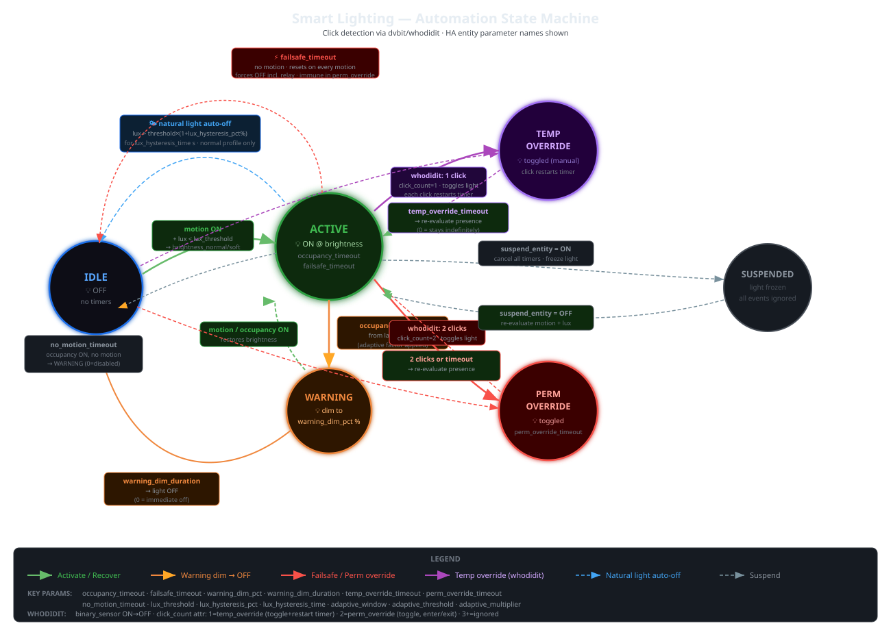
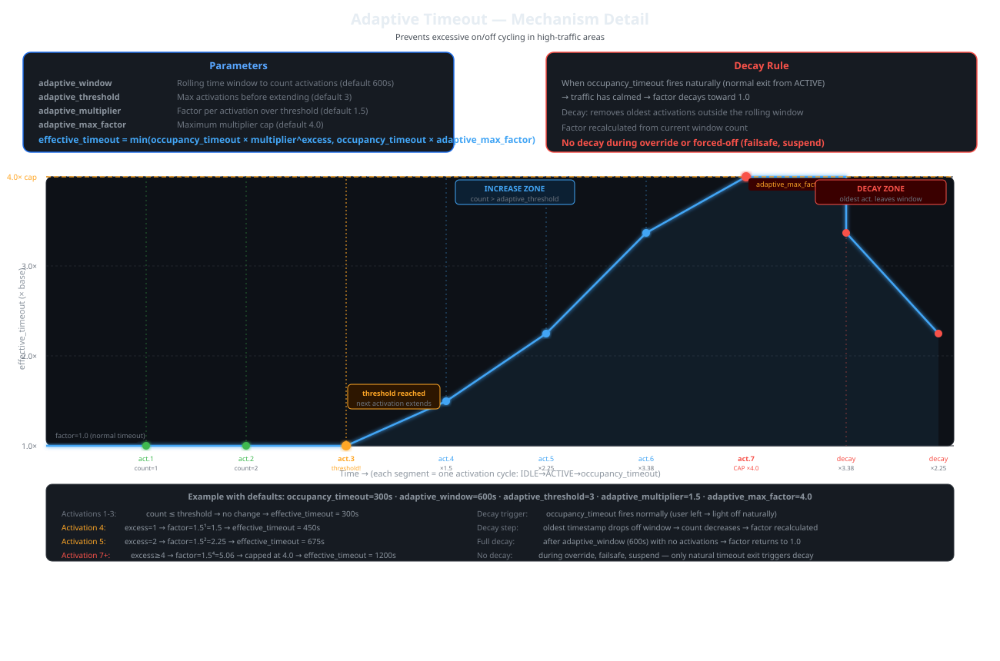

# Smart Lighting

[](https://github.com/hacs/integration)

Automazione dell'illuminazione per aree in Home Assistant: movimento, occupazione e luce ambiente comandano le luci, con preavviso di spegnimento, override manuali, timeout adattivo e spegnimento per luce naturale.

🇬🇧 [Read in English](README.md) · 📄 [Specifica](smart_lighting_spec.md)

## Caratteristiche

- **Configurazione per area** — selettore area HA, selettori entità filtrati sull'area
- **Movimento + occupazione** — il movimento accende (logica OR tra sensori), l'occupazione mantiene accesa la luce
- **Sensibile alla luce** — accende solo sotto una soglia configurabile
- **Due profili di luminosità** — normale e soft, scelti per fascia oraria o da un'entità
- **Più lampadine per relè** — il relè resta acceso così le lampadine smart restano raggiungibili
- **Attuatori soft alternativi** — lampadine/relè dedicati al profilo soft
- **Preavviso di spegnimento** — abbassa la luce prima di spegnerla
- **Override manuale** — click singolo (temporaneo) e doppio click (permanente) tramite [whodidit](https://github.com/dvbit/whodidit)
- **Sicurezza** — senza movimento a lungo si spegne tutto
- **Spegnimento per luce naturale** — spegne quando entra luce diurna (es. tapparelle aperte)
- **Timeout adattivo** — timeout più lungo nelle aree di passaggio, poi torna normale
- **Sospensione** — un'entità esterna mette in pausa l'automazione (es. modalità film)
- **Regolabile a runtime** — ogni tempo è anche un'entità numero; i valori sopravvivono al riavvio
- **Dispositivo virtuale** — tutte le entità raggruppate in un dispositivo per area
- **Card Lovelace** — auto-registrata, barra timer, indicatore modalità, popup impostazioni
- **Multilingua** — EN, IT, FR, ES, DE (config flow con descrizione sotto ogni campo, nomi entità, card)

## Installazione

### HACS (consigliato)

1. HACS → Integrazioni → ⋮ → Repository personalizzati
2. Aggiungi `https://github.com/dvbit/smart-lighting` come **Integration**
3. Cerca "Smart Lighting" e installa
4. Riavvia Home Assistant

La card Lovelace viene registrata automaticamente come risorsa frontend.

### Manuale

Copia `custom_components/smart_lighting/` in `config/custom_components/` e riavvia.

## Configurazione

**Impostazioni → Dispositivi e servizi → Aggiungi integrazione → Smart Lighting**. Una voce per area.

Ogni campo del modulo mostra un nome breve e, sotto, la descrizione di cosa fa. Lo stesso testo è riportato qui. Tutti i valori si modificano in seguito con **Configura** (l'integrazione si ricarica) e tutti i tempi sono anche entità numero, applicate subito.

### Passo 1: Area

Scegli l'area di Home Assistant gestita da questo controller. I passi successivi mostrano solo le entità assegnate a quest'area.

| Campo | Chiave | Default | Intervallo | Significato |
|---|---|---|---|---|
| **Area** | `area_id` | — | — | Area di Home Assistant gestita da questo controller. Il suo nome diventa il nome del dispositivo; i selettori dei passi successivi sono filtrati su di essa. |

> **Esempio** — Scegli `Cucina`: il dispositivo viene creato come *Smart Lighting Cucina* e i selettori successivi mostrano solo le entità della cucina.

### Passo 2: Sensori

Sensori di presenza e di luce ambiente che guidano l'automazione. Sensori di movimento, occupazione e luminosità sono obbligatori.

| Campo | Chiave | Default | Intervallo | Significato |
|---|---|---|---|---|
| **Sensori di movimento** | `motion_sensors` | — | ≥ 1 | Uno o più binary_sensor (es. PIR). Basta che uno si attivi (logica OR) per accendere la luce, se la luce ambiente è sotto la soglia lux. Ogni movimento riavvia anche il conto alla rovescia di occupazione e il timer di sicurezza, e annulla il preavviso di spegnimento. |
| **Sensore di occupazione** | `occupancy_sensor` | — | 1 | Binary_sensor di presenza statica (es. mmWave). Finché è attivo il conto alla rovescia di spegnimento è sospeso; quando si disattiva parte il timeout di occupazione. Decide anche se l'area è ancora occupata alla scadenza di un override temporaneo. |
| **Sensore di luminosità** | `lux_sensor` | — | 1 | Sensore della luce ambiente in lux. La luce si accende solo se la lettura è sotto la soglia lux. Se non disponibile o non numerico, l'area è considerata buia. |
| **Soglia lux (lx)** | `lux_threshold` | 50 lx | 0–1000 | Livello di luce ambiente sotto il quale il movimento accende la luce. Se la luce è accesa, la lettura raggiunge questo valore e il sensore di occupazione è spento, la luce si spegne. Suggerimento: il pulsante 'Imposta soglia lux' memorizza la lettura attuale. |

> **Esempio** — Cucina con un PIR sulla porta (`binary_sensor.cucina_pir`), un mmWave sul tavolo (`binary_sensor.cucina_presenza`) e la luminosità dell'mmWave (`sensor.cucina_lux`), soglia `40`: la luce si accende quando qualcuno entra e la stanza è sotto i 40 lx, e resta accesa finché l'mmWave vede qualcuno seduto.

### Passo 3: Attuatori

Entità comandate dal controller, più gli ingressi opzionali di override e sospensione. È obbligatorio almeno uno tra lampadine smart e relè.

| Campo | Chiave | Default | Intervallo | Significato |
|---|---|---|---|---|
| **Lampadine smart** | `bulb_entity` | — | 0..n | Opzionale. Una o più entità light, accese tutte con la luminosità del profilo attivo. Se è impostato anche un relè, allo spegnimento si spengono solo le lampadine e il relè resta acceso, così restano raggiungibili. |
| **Relè** | `relay_entity` | — | 0..1 | Switch opzionale che alimenta il circuito. Senza lampadine viene acceso/spento direttamente. Con le lampadine viene acceso insieme a loro e lasciato acceso allo spegnimento; lo spegne solo il timer di sicurezza. |
| **Sensore interazione fisica** | `physical_interaction_sensor` | — | 0..1 | Binary_sensor opzionale dell'integrazione whodidit. Alla chiusura della finestra dei click (on → off) viene letto l'attributo click_count: 1 click = override temporaneo, 2 click = entra/esce dall'override permanente, 3 o più = ignorati. |
| **Lampadine profilo soft** | `soft_bulb_entity` | — | 0..n | Opzionale. Entità light usate al posto delle lampadine smart quando il profilo soft è attivo (es. una lampada notturna). Se non sono impostati né lampadine né relè soft, si usano gli attuatori normali. |
| **Relè profilo soft** | `soft_relay_entity` | — | 0..1 | Opzionale. Switch usato al posto del relè quando il profilo soft è attivo. Stesse regole del relè principale. |
| **Entità di sospensione** | `suspend_entity` | — | 0..1 | Binary_sensor o input_boolean opzionale. Quando è attiva l'automazione è in pausa: timer annullati, luce lasciata com'è e tutti gli eventi ignorati (es. modalità film). Quando si disattiva, movimento e lux vengono rivalutati. |

> **Esempio** — Plafoniera con lampadina Zigbee dietro un relè a muro: lampadine `light.cucina_plafoniera`, relè `switch.cucina_rele`. Il relè resta acceso così la lampadina non esce mai dalla rete Zigbee. Aggiungi `light.cucina_sottopensile` come *lampadine profilo soft* per usare di notte solo il sottopensile, e `binary_sensor.cucina_interruttore_whodidit` come *sensore interazione fisica* per abilitare gli override dall'interruttore.

### Passo 4: Tempi

Timer di spegnimento, preavviso, timeout adattivo e spegnimento per luce naturale. Ogni valore è modificabile anche in seguito dalle entità numero del dispositivo, senza riconfigurare.

| Campo | Chiave | Default | Intervallo | Significato |
|---|---|---|---|---|
| **Timeout occupazione (s)** | `occupancy_timeout` | 300 s | 10–7200 | Conto alla rovescia prima dello spegnimento. Parte quando la presenza termina (sensore di occupazione spento, o movimento spento se manca il sensore di occupazione), riparte a ogni movimento e si annulla quando l'occupazione ritorna. Alla scadenza inizia il preavviso. Moltiplicato dal fattore adattivo nelle aree di passaggio. |
| **Timeout di sicurezza (s)** | `failsafe_timeout` | 3600 s | 60–86400 | Rete di sicurezza: senza movimento per questo tempo si spegne tutto, relè compreso (protegge da un sensore di occupazione bloccato su attivo). Riparte a ogni movimento. Ignorato durante l'override permanente. |
| **Timeout override permanente (s)** | `perm_override_timeout` | 3600 s | 60–86400 | Durata massima dell'override permanente (doppio click). Alla scadenza la luce si spegne e riprende la modalità automatica. |
| **Timeout override temporaneo (s)** | `temp_override_timeout` | 0 s | 0–86400 | In override temporaneo (click singolo) ogni click inverte la luce e riavvia questo timer. Alla scadenza riprende la modalità automatica: luce accesa se l'area è occupata e buia, altrimenti spenta. 0 = non scade mai da solo. |
| **Preavviso: luminosità (%)** | `warning_dim_pct` | 30 % | 5–80 | Prima dello spegnimento le lampadine scendono a questa percentuale della luminosità attuale, per avvisare chi è ancora nella stanza. Qualsiasi movimento o occupazione annulla il preavviso e ripristina la luminosità. Efficace solo con lampadine smart. |
| **Preavviso: durata (s)** | `warning_dim_duration` | 10 s | 3–60 | Per quanto tempo la luce resta abbassata prima di spegnersi. |
| **Finestra adattiva (s)** | `adaptive_window` | 600 s | 60–3600 | Finestra temporale mobile in cui si contano le accensioni automatiche per riconoscere un'area di passaggio. |
| **Soglia adattiva** | `adaptive_threshold` | 3 | 2–20 | Numero di accensioni nella finestra oltre il quale il timeout di occupazione inizia ad allungarsi. |
| **Moltiplicatore adattivo** | `adaptive_multiplier` | 1.5 | 1.1–3.0 | Ogni accensione oltre la soglia moltiplica il timeout di occupazione per questo fattore (fattore = moltiplicatore ^ accensioni in eccesso). Esempio: 1,5 con 2 accensioni in eccesso → ×2,25. |
| **Fattore adattivo massimo** | `adaptive_max_factor` | 4.0 | 1.5–10.0 | Limite superiore dell'allungamento (es. 4,0 → al massimo 4× il timeout di occupazione). Ogni volta che il timeout scade normalmente, la parte in eccesso del fattore si dimezza. |
| **Margine luce naturale (%)** | `lux_hysteresis_pct` | 10 % | 5–100 | Spegnimento per luce naturale: con la luce accesa nel profilo normale, se la luce ambiente supera soglia × (1 + margine/100) la luce si spegne anche se l'area è occupata (es. tapparelle aperte). |
| **Ritardo luce naturale (s)** | `lux_hysteresis_time` | 5 s | 1–30 | Secondi in cui la lettura deve restare sopra il margine prima dello spegnimento per luce naturale, per ignorare picchi brevi. |

> **Esempio** — Corridoio: timeout occupazione `60`, preavviso `30 %` per `10 s`. Se si passa più di 3 volte in 10 minuti (soglia `3`, finestra `600`), ogni accensione in più moltiplica i 60 s per `1,5`, fino a `4,0` → massimo 240 s. Con soglia `50 lx` e margine `10 %`, aprendo le tapparelle (lux ≥ 55 per `5 s`) la luce si spegne.

### Passo 5: Profili di luminosità

Luminosità usata all'accensione automatica: profilo normale, oppure profilo soft (es. di notte) scelto per fascia oraria o da un'entità.

| Campo | Chiave | Default | Intervallo | Significato |
|---|---|---|---|---|
| **Luminosità normale** | `brightness_normal` | 255 | 1–255 | Luminosità (1–255) del profilo normale. 255 = 100%. |
| **Luminosità soft** | `brightness_soft` | 100 | 1–255 | Luminosità (1–255) usata quando il profilo soft è attivo, es. di notte. 100 ≈ 40%. |
| **Attivazione profilo soft** | `profile_mode` | time | time / entity | Come si sceglie il profilo soft: 'Fascia oraria' usa inizio e fine qui sotto; 'Entità' segue l'entità del profilo soft. |
| **Inizio profilo soft** | `soft_time_start` | 20:00 | 00:00–23:59 | Solo in modalità fascia oraria. Ora di inizio del profilo soft. Sono ammesse fasce a cavallo della mezzanotte (es. 20:00–08:00). |
| **Fine profilo soft** | `soft_time_end` | 08:00 | 00:00–23:59 | Solo in modalità fascia oraria. Ora di fine del profilo soft. |
| **Entità profilo soft** | `soft_entity` | — | 0..1 | Solo in modalità entità. Binary_sensor o input_boolean: quando è attivo, il profilo soft è attivo (es. un helper 'modalità notte'). |

> **Esempio** — Normale `255`, soft `60`, modalità *Fascia oraria* `22:30`–`06:30`: di notte la luce si accende a circa il 25 % (e con le lampadine soft, se impostate). Con modalità *Entità* e `input_boolean.modalita_notte`, il profilo soft segue quell'helper.


## Entità

Ogni area crea un dispositivo *Smart Lighting &lt;Area&gt;* con queste entità (gli entity_id sono sempre in inglese, i nomi seguono la lingua di HA):

### Luce

| Entità | Descrizione |
|---|---|
| `light.smart_lighting_<area>` | Controller principale. Accendi/spegni da UI = click singolo (override temporaneo) |

### Sensori (diagnostica)

| Entità | Descrizione |
|---|---|
| `sensor.*_state` | Macchina a stati: idle, active, warning, temp_override, perm_override, suspended |
| `sensor.*_profile` | Profilo attivo: normal o soft |
| `sensor.*_occupancy_timer` | Conto alla rovescia occupazione rimanente (s) |
| `sensor.*_failsafe_timer` | Sicurezza rimanente (s) |
| `sensor.*_override_timer` | Override attivo rimanente (s) |
| `sensor.*_warning_timer` | Preavviso rimanente (s) |
| `sensor.*_adaptive_factor` | Moltiplicatore adattivo attuale |
| `sensor.*_activation_count` | Accensioni nella finestra adattiva |
| `sensor.*_lux` | Luce ambiente (lx), copia del sensore di luminosità |

### Numeri (configurazione, runtime, persistenti)

`number.*_<chiave>` per ogni tempo del passo 4 più `lux_threshold`: `occupancy_timeout`, `failsafe_timeout`, `perm_override_timeout`, `temp_override_timeout`, `warning_dim_pct`, `warning_dim_duration`, `lux_threshold`, `adaptive_window`, `adaptive_threshold`, `adaptive_multiplier`, `adaptive_max_factor`, `lux_hysteresis_pct`, `lux_hysteresis_time`. Stesso significato della tabella sopra; le modifiche valgono subito e vengono salvate nella voce.

### Pulsante

| Entità | Descrizione |
|---|---|
| `button.*_set_lux_threshold` | Memorizza la lettura attuale di luminosità come nuova soglia lux |

## Macchina a stati



## Logica principale

- **Accensione**: movimento + lux sotto soglia → luce accesa alla luminosità del profilo attivo.
- **Spegnimento**: fine presenza → timeout occupazione → preavviso → spenta.
- **Attuazione**: lampadine + relè → accensione: tutte le lampadine + relè; spegnimento: lampadine spente, relè acceso. Solo lampadine o solo relè → on/off semplice. Gli attuatori soft sostituiscono quelli normali quando il profilo soft è attivo.
- **Sicurezza**: nessun movimento per `failsafe_timeout` → tutto spento, relè compreso. L'override permanente è immune.

## Override manuale (whodidit)

Imposta *Sensore interazione fisica* sul `binary_sensor` whodidit dell'interruttore a muro. Alla chiusura della finestra dei click viene letto `click_count`:

| Click | Effetto |
|---|---|
| 1 | **Override temporaneo**: inverte la luce; ogni click successivo la inverte di nuovo e riavvia `temp_override_timeout`. Alla scadenza: accesa se occupata e buia, altrimenti spenta. Nel frattempo movimento e occupazione sono ignorati |
| 2 | **Override permanente**: inverte la luce e la congela, immune alla sicurezza. Un altro doppio click o `perm_override_timeout` riporta all'automatico |
| 3+ | Ignorati |

## Spegnimento per luce naturale

Con la luce accesa nel profilo normale, se la luce ambiente resta sopra `lux_threshold × (1 + lux_hysteresis_pct/100)` per `lux_hysteresis_time` secondi, la luce si spegne.

## Timeout adattivo



`fattore = min(adaptive_multiplier ^ (accensioni − adaptive_threshold), adaptive_max_factor)`, contato su `adaptive_window`. Ogni scadenza normale del timeout di occupazione dimezza la parte in eccesso del fattore.

## Sospensione

Finché `suspend_entity` è attiva: stato `suspended`, timer annullati, luce non toccata. Quando si disattiva, movimento e lux vengono rivalutati.

## Card

```yaml
type: custom:smart-lighting-card
area: cucina                    # slug dell'area usato negli entity_id
name: Cucina                    # nome visualizzato opzionale
icon_main: mdi:ceiling-light    # opzionale, icona profilo normale
icon_soft: mdi:lamp             # opzionale, icona profilo soft
```

Barra timer, icona grande per accendere/spegnere, indicatore modalità, icone movimento/occupazione/lux (tap = more-info) e popup impostazioni con tutte le entità numero e il pulsante *Imposta soglia lux*.

## Esempio di automazione

Attiva l'helper di sospensione quando la TV avvia un film:

```yaml
alias: Soggiorno - la modalità film sospende Smart Lighting
triggers:
  - trigger: state
    entity_id: media_player.tv_soggiorno
    to: playing
actions:
  - action: input_boolean.turn_on
    target:
      entity_id: input_boolean.soggiorno_modalita_film
mode: single
```

## Licenza

MIT
